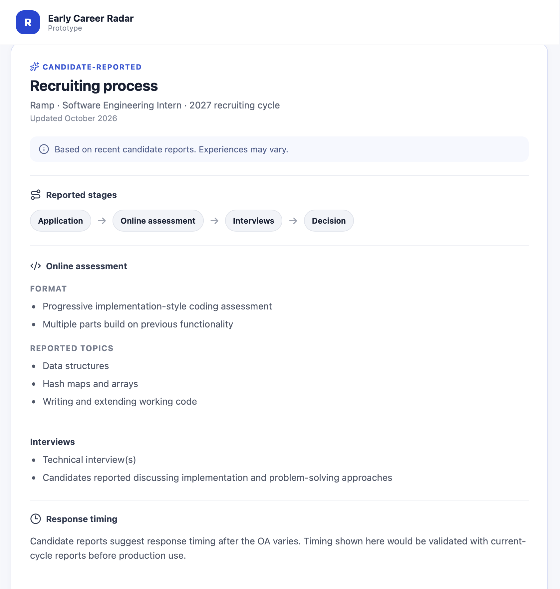
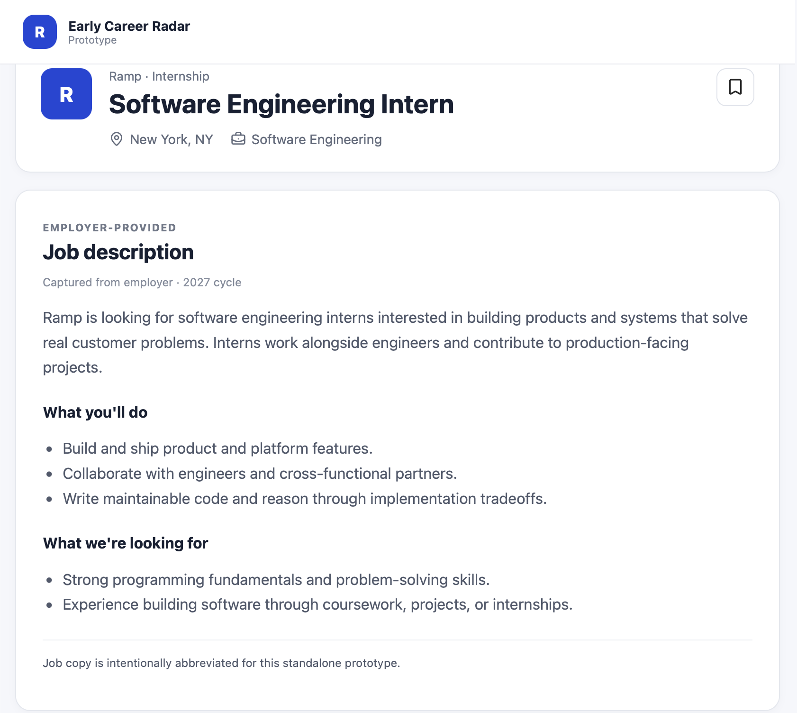
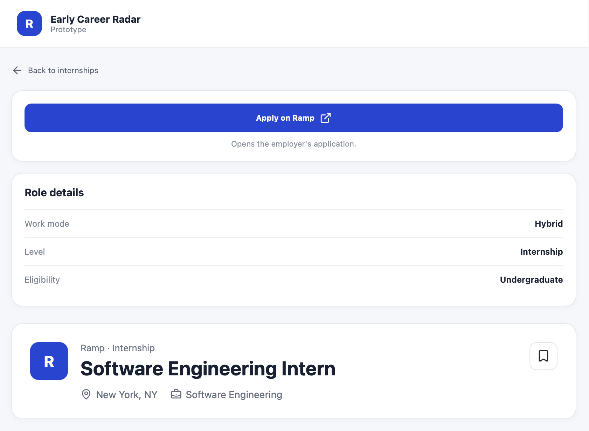

# Radar Candidate Recruiting Insights

A small React prototype for an idea I explored while using Early Career Radar.

## The problem

When I received an online assessment or interview, I would leave Radar and search places like Reddit or InternDB to learn what previous candidates experienced.

That information can be scattered and hard to match to the same role and recruiting year.

## The idea

Show recent candidate-reported recruiting information directly on the job page, including:

- Recruiting stages
- OA/interview format and topics
- Approximate response timing
- Recruiting cycle and last updated date

For this prototype, I used **Ramp —> Software Engineering Intern, 2027** as the example.

## Why I kept it small

The goal is to first see whether students find this information useful. The prototype uses simple example data and does not need a backend or database yet.

## Built with

- React
- Vite
- CSS

## Run locally

```bash
git clone https://github.com/Cyrila7/radar-candidate-insights-prototype.git
cd radar-candidate-insights-prototype
npm install
npm run dev
```

## Prototype screenshots

The screenshots below show an **independent concept prototype**, not a feature currently available on Early Career Radar. The Ramp listing and candidate-report information are illustrative sample content.

### 1. Candidate recruiting insights



### 2. Internship description context



### 3. Job details and application flow


